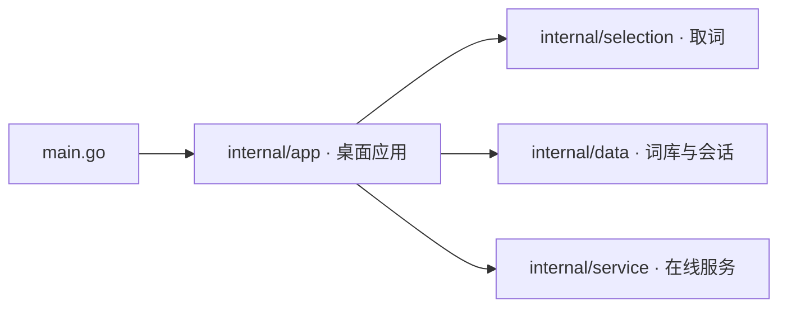

# Repository Guidelines

Go Ask 让用户通过同一个快捷键查词、翻译句段，并在同一浮窗中切换到 AI 问答。应用默认后台待命。

## 架构总览

Go Ask 使用 Go 和 NSGo 开发 Windows 与 Linux 桌面应用。根目录的 `main.go` 嵌入托盘图标并调用 `app.Run`，`nsgo.yaml` 保存应用标识和框架配置。

## 模块索引

- [internal/app](internal/app/AGENTS.md) 管理桌面窗口、托盘、设置与多服务调度。翻译和问答流程分别在 `translation.go`、`chat.go`。
- [internal/selection](internal/selection/AGENTS.md) 读取前台应用的选区。Windows 和 Linux 分别实现同一个 `selection.Text` 入口。
- [internal/service](internal/service/AGENTS.md) 提供服务目录，适配免配置翻译、云翻译和 OpenAI 兼容接口。认证、请求和响应解析放在此包。
- [internal/data](internal/data/AGENTS.md) 负责 SQLite 会话历史与离线词典。更新词库前阅读 [数据来源与生成说明](internal/data/dictionary/SOURCE.md)。
- `assets/` 存放图标和 Linux 桌面入口。测试与被测代码放在同一目录。

## 本地开发与构建

在仓库根目录执行以下命令。Go 版本以 `go.mod` 为准，Linux 桌面运行需要 GTK 4。

- `go run -ldflags="-X github.com/nsgo-dev/nsgo/core.appID=dev.goask.GoAsk" .` 启动开发实例。保留应用 ID 以验证单实例唤回。启动后按 `Ctrl+Q` 显示浮窗。
- `go test ./internal/service` 单独验证服务接入；`go test ./...` 运行全部测试。
- `go vet ./...` 执行静态检查。
- `python3 tools/package.py` 构建 Windows 和 Linux 的 amd64 发布包，输出到已被 Git 忽略的 `dist/`。

## 代码风格与命名

用 `gofmt` 格式化改动的 Go 文件，由工具处理制表符缩进。包名使用小写，导出标识符使用 `MixedCaps`。平台专属实现沿用 `selection_windows.go` 和 `selection_linux.go` 的文件后缀。界面文案使用简体中文，服务密钥通过系统凭据存储读写。

## 测试与桌面验收

在 `*_test.go` 中用 `TestXxx` 命名测试。服务测试使用 `httptest` 模拟响应，历史记录测试使用 `t.TempDir()` 创建临时数据库。界面流程沿用 `nsgotest`，可运行 `go test -run TestChatWindowRemembersConversation ./internal/app` 验证追问和重启恢复。

修改热键、托盘或取词时，在受影响的桌面环境实际操作。例如，选中文字后按 `Ctrl+Q`，检查输入焦点和查询结果，再按 `Esc` 验证收起。Linux 验收注明 X11 或 Wayland。

## AI 使用指引

定位问题时先读对应模块索引。查词框显示异常从 `internal/app` 入手；取到旧选区查 `internal/selection`；服务返回错误查 `internal/service`；重启后找不到会话查 `internal/data`。修改模块入口、接口、职责或依赖时，同步对应模块索引和根索引中的引用。

## 提交与拉取请求

仓库目前没有提交历史。建议每次提交聚焦一项改动，用简短中文标题说明行为，例如「修复设置窗口重复打开」。PR 说明改动原因、测试命令与实测平台；有对应 issue 时关联，涉及可见变化时附窗口截图。

## 索引状态

- 上次索引：2026-11-20T09:09:41Z
- 基线提交：无
- 已知缺口：无
- 扫描进度：已完成
